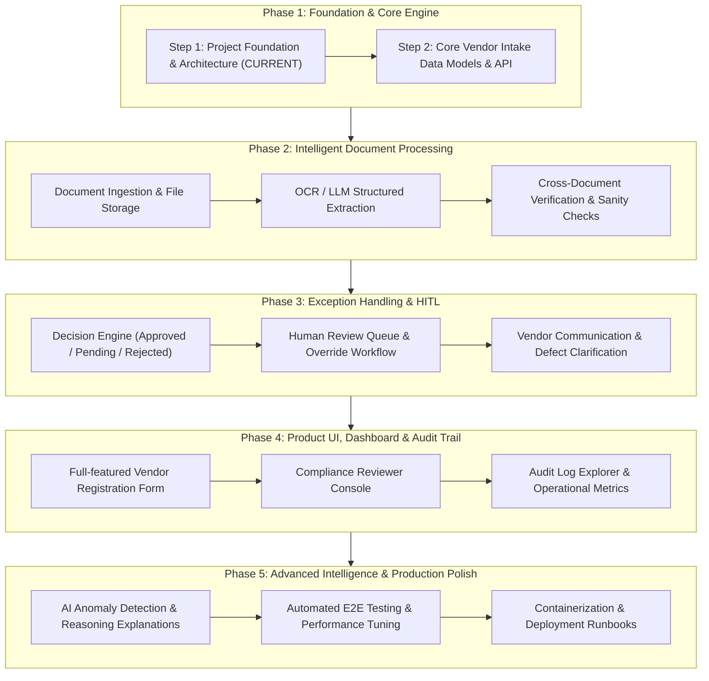

# Zamp AI Solutions Analyst Case Study
## Architecture Design Document — Vendor Onboarding Automation

**Author:** Lead Software Engineer  
**Version:** 1.0.0 (Phase 1 — Step 1)  
**Status:** Approved & Implemented Foundation  

---

## 1. Executive Summary & Objective

The **Zamp Vendor Onboarding Automation** platform is an intelligent, automated system designed to ingest, process, validate, and adjudicate vendor onboarding submissions. A vendor onboarding submission entails:
1. **Company Information:** Legal entity name, country of incorporation, registration/tax numbers (EIN/VAT/GST), and registered addresses.
2. **Banking Information:** Beneficiary name, IBAN / account numbers, SWIFT/BIC codes, routing details, and currency designations.
3. **Tax & Regulatory Details:** Tax forms (e.g., W-9, W-8BEN-E, VAT certificates) and compliance classifications.
4. **Supporting Documents:** Scanned PDFs/images of bank statements, certificates of incorporation, proof of address, and signatory authorizations.

The target system is built to autonomously parse multi-source data, cross-validate field consistency (e.g. matching legal company name on tax forms vs. bank statement vs. web form), detect anomalies, generate an explainable decision (**Approved / Pending / Rejected**), and communicate deficiencies to vendors or flag ambiguous submissions to human compliance reviewers.

This architecture has been designed from day one to scale through five progressive phases while avoiding premature complexity and preventing costly architectural refactoring.

---

## 2. Technology Selection & Justification

| Layer | Selected Technology | Alternative Considered | Justification |
| :--- | :--- | :--- | :--- |
| **Frontend Framework** | **React 18 + TypeScript** | Next.js, Vue 3 | React with TypeScript provides industry-standard stability, strict type safety across complex vendor state trees, strong UI ecosystem, and fast client-side rendering. For a dedicated enterprise workflow portal, a Vite-backed SPA avoids server-side rendering (SSR) overhead and complex edge runtime constraints. |
| **Styling** | **Tailwind CSS** | Material UI, CSS Modules | High-velocity development, zero runtime style overhead, predictable layout control, and unified design token primitives suitable for high-density enterprise review consoles. |
| **Backend Framework** | **Python (FastAPI)** | Node.js (Express/Nest), Go | FastAPI offers native async performance, automatic OpenAPI/Swagger documentation generation, strict data validation with Pydantic v2, and direct first-class compatibility with the Python AI/ML ecosystem (LangChain, LlamaIndex, PyMuPDF, OCR engines, Gemini/OpenAI SDKs). |
| **Data Validation** | **Pydantic v2** | Marshmallow, Cerberus | Native FastAPI integration, high-speed C-based core (pydantic-core), explicit schemas for API request/response contracts, and seamless data parsing for messy document extraction payloads. |
| **Persistence / ORM** | **SQLAlchemy 2.0** | Raw SQL, Tortoise ORM | Modern typing, complete database-agnostic abstraction, Unit of Work and Repository pattern support, and smooth migration paths. |
| **Database Engine** | **SQLite (Dev) / PostgreSQL (Prod)** | MongoDB, DynamoDB | Relational integrity is mandatory for compliance, vendor state machines, and relational audit logging. SQLite delivers zero-friction, self-contained local development without external daemon requirements, while standard SQLAlchemy engine abstraction enables instant switching to PostgreSQL via a single `DATABASE_URL` environment variable. |
| **Icons & Design** | **Lucide React** | Heroicons, FontAwesome | Modern, lightweight, customizable SVG iconography for clean enterprise indicators. |

---

## 3. High-Level System Architecture

The application adopts a **Modular Monolith** architecture. Microservices are deliberately avoided to eliminate distributed systems complexity, network latency, distributed transactions, and infrastructure maintenance within the case-study timeframe.

```
+-----------------------------------------------------------------------------------+
|                                PRESENTATION TIER                                  |
|                                                                                   |
|  React 18 + TypeScript (Vite)                                                     |
|  +-------------------------+  +-------------------------+  +--------------------+ |
|  | Vendor Intake Portal    |  | Compliance Review Ops   |  | Audit Trail & Logs | |
|  +-------------------------+  +-------------------------+  +--------------------+ |
+------------------------------------------+----------------------------------------+
                                           | HTTP / REST (JSON)
                                           v
+-----------------------------------------------------------------------------------+
|                                  API GATEWAY TIER                                 |
|                                                                                   |
|  FastAPI Routing & Lifecycle (`backend/app/api/`)                                 |
|  +-----------------------------------------------------------------------------+  |
|  | CORS Middleware | Pydantic Request Validation | Auth & RBAC (Future)        |  |
|  +-----------------------------------------------------------------------------+  |
|  | /api/v1/health  | /api/v1/vendors  | /api/v1/documents | /api/v1/reviews     |  |
+------------------------------------------+----------------------------------------+
                                           |
                                           v
+-----------------------------------------------------------------------------------+
|                              BUSINESS / SERVICE TIER                              |
|                                                                                   |
|  Decoupled Pure Domain Logic (`backend/app/services/`)                            |
|  +-----------------------+ +-----------------------+ +--------------------------+ |
|  | Vendor Intake Service | | Document OCR & Storage| | Cross-Validation Service | |
|  +-----------------------+ +-----------------------+ +--------------------------+ |
|  +-----------------------+ +-----------------------+ +--------------------------+ |
|  | Decision Engine       | | Human Review Service  | | Audit Logging Service    | |
|  +-----------------------+ +-----------------------+ +--------------------------+ |
+------------------------------------------+----------------------------------------+
                                           |
                                           v
+-----------------------------------------------------------------------------------+
|                              PERSISTENCE & STORAGE TIER                           |
|                                                                                   |
|  SQLAlchemy 2.0 Session Factory (`backend/app/db/`)                               |
|  +-------------------------------------+ +--------------------------------------+ |
|  | Relational Schema (SQLite / Postgres) | Local Filesystem / S3 Blob Storage   | |
|  +-------------------------------------+ +--------------------------------------+ |
+-----------------------------------------------------------------------------------+
```

---

## 4. Planned Module Boundaries & Future Phase Mapping

To guarantee that later phases plug in seamlessly without rewriting foundational code, service boundaries are strictly isolated behind Python classes and functions:

### 4.1 Vendor Submission Module (`services/vendor_service.py`)
- **Phase Target:** Phase 1 (Step 2) & Phase 2.
- **Responsibilities:** Ingests company profile, tax IDs, banking information, and submission metadata. Manages the lifecycle state machine (`DRAFT` -> `SUBMITTED` -> `UNDER_REVIEW` -> `APPROVED` / `REJECTED` / `PENDING_INFO`).

### 4.2 Document Storage & Ingestion (`services/document_service.py`)
- **Phase Target:** Phase 2.
- **Responsibilities:** Handles multipart file uploads (PDF, PNG, JPG). Computes SHA-256 cryptographic hashes for document immutability, stores files in structured local directories or cloud object storage, and tracks document metadata.

### 4.3 Data Extraction & OCR Engine (`services/extraction_service.py`)
- **Phase Target:** Phase 2.
- **Responsibilities:** Extracts textual and tabular data from unstructured files (e.g. extracting Tax ID from a W-9, account numbers and bank name from a voided cheque or statement). Produces normalized JSON representations with confidence scores.

### 4.4 Deterministic Validation Module (`services/validation_service.py`)
- **Phase Target:** Phase 2 & 3.
- **Responsibilities:**
  - Field-level syntax checks (IBAN checksum validation, EIN format, VAT syntax per jurisdiction).
  - Cross-source entity reconciliation (e.g., does the name on the bank document match the registered company name?).
  - Expiration checks on compliance certificates.

### 4.5 Decision Making Engine (`services/decision_service.py`)
- **Phase Target:** Phase 3.
- **Responsibilities:** Applies rules and heuristics to synthesize validation outputs into a concrete onboarding decision:
  - **APPROVED:** All critical checks pass with high confidence.
  - **PENDING / REQUIREMENT_MISSING:** Minor discrepancies, illegible document, or missing mandatory certificate. Generates actionable feedback.
  - **REJECTED:** Fraud alert, sanctions match, or fundamentally invalid credentials.

### 4.6 Human-in-the-Loop Review Console (`services/review_service.py`)
- **Phase Target:** Phase 3.
- **Responsibilities:** Flags ambiguous cases (confidence score < threshold or flagged conflicts) to human operators. Records reviewer notes, manual overrides, and approval timestamps.

### 4.7 Communication & Notification Module (`services/communication_service.py`)
- **Phase Target:** Phase 3.
- **Responsibilities:** Generates standardized vendor email/messages detailing onboarding approval or itemized requirements to resolve pending status.

### 4.8 Immutable Audit Trail (`services/audit_service.py`)
- **Phase Target:** Phase 4.
- **Responsibilities:** Logs every state transition, validation result, document upload, and user action with timestamps, actor IDs, and payload snapshots.

---

## 5. Five-Phase Implementation Roadmap



---

## 6. Security, Configuration & Secrets Management

1. **Zero Hardcoded Credentials:** All credentials, hosts, and environment secrets are ingested through environment variables (`.env`).
2. **Pydantic BaseSettings:** Settings are typed and validated upon process startup; misconfigurations fail fast with actionable errors.
3. **CORS Governance:** Strict explicit origin whitelist configuration (`CORS_ORIGINS`) prevents unauthorized cross-origin browser requests.
4. **Data Isolation:** Database connections use parameterized queries via SQLAlchemy 2.0 to eliminate SQL injection vulnerabilities.
5. **Git Hygiene:** `.gitignore` actively excludes `.env`, `*.db`, SQLite storage, `node_modules`, `__pycache__`, and temporary test artifacts.

---

## 7. Operational Standards & Local Development Runbook

- **Frontend:** Managed through Vite development server on port `5173`.
- **Backend:** Managed through Uvicorn ASGI server on port `8000`.
- **Health Verification:** Monitored via `/api/v1/health` and `/healthz`.
- **API Documentation:** Interactive Swagger UI available at `http://localhost:8000/docs`.
