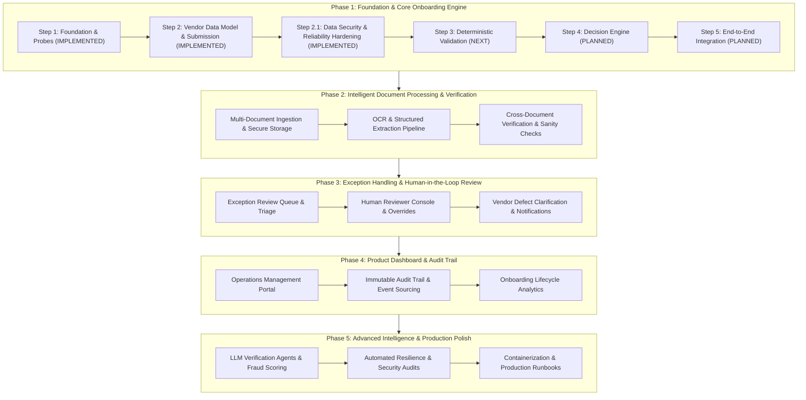

# Zamp AI Solutions Analyst Case Study
## Architecture Design Document — Vendor Onboarding Automation

**Author:** Lead Software Engineer  
**Version:** 1.2.0 (Phase 1 — Step 2.1 Hardening Iteration)  
**Status:** Approved & Implemented Foundation & Security Hardening  

---

## 1. Executive Summary & Objective

The **Zamp Vendor Onboarding Automation** platform is an intelligent, automated system designed to ingest, process, validate, and adjudicate vendor onboarding submissions. A vendor onboarding submission entails:
1. **Company Information:** Legal entity name, country of incorporation, registration/tax numbers (EIN/VAT/GST), and registered addresses.
2. **Banking Information:** Beneficiary name, IBAN / account numbers, SWIFT/BIC codes, routing details, and currency designations.
3. **Tax & Regulatory Details:** Tax forms (e.g., W-9, W-8BEN-E, VAT certificates) and compliance classifications.
4. **Supporting Documents:** Scanned PDFs/images of bank statements, certificates of incorporation, proof of address, and signatory authorizations.

The target system is built to autonomously parse multi-source data, cross-validate field consistency (e.g. matching legal company name on tax forms vs. bank statement vs. web form), detect anomalies, generate an explainable decision (**Approved / Pending / Rejected**), and communicate deficiencies to vendors or flag ambiguous submissions to human compliance reviewers.

This architecture has been designed from day one to scale through five progressive phases while avoiding premature complexity and preventing costly architectural refactoring.

---

## 2. Technology Selection & Driver Requirements

| Layer | Selected Technology | Alternative Considered | Justification & Driver Requirements |
| :--- | :--- | :--- | :--- |
| **Frontend Framework** | **React 18 + TypeScript** | Next.js, Vue 3 | React with TypeScript provides industry-standard stability, compile-time type safety across complex vendor state trees, strong UI ecosystem, and fast client-side rendering. For an operational workflow portal, a Vite-backed SPA avoids server-side rendering (SSR) overhead and edge runtime constraints. |
| **Styling** | **Tailwind CSS** | Material UI, CSS Modules | High-velocity development, zero runtime style overhead, predictable layout control, and unified design token primitives suitable for high-density enterprise review consoles. |
| **Backend Framework** | **Python (FastAPI) + Uvicorn** | Node.js (Express/Nest), Go | FastAPI offers native async performance, automatic OpenAPI/Swagger documentation generation (`/docs`), strict data validation with Pydantic v2, and direct first-class compatibility with the Python AI/ML ecosystem (LangChain, LlamaIndex, PyMuPDF, OCR engines, Gemini/OpenAI SDKs). |
| **Data Validation** | **Pydantic v2 + pydantic-settings** | Marshmallow, Cerberus | Native FastAPI integration, high-speed C-based core (`pydantic-core`), explicit schemas for API request/response contracts, and fail-fast environment variable validation. |
| **Persistence / ORM** | **SQLAlchemy 2.0** | Raw SQL, Tortoise ORM | Modern typing, complete database-agnostic abstraction, Unit of Work and Repository pattern support, and clean migration paths. |
| **Database Engine** | **SQLite (Active Dev) / PostgreSQL (Production Target)** | MongoDB, DynamoDB | Relational integrity is mandatory for compliance, vendor state machines, and relational audit logging. **SQLite is the currently active and fully installed driver** (`sqlite3` standard library), providing zero-dependency local development and predictable absolute path resolution. **PostgreSQL is supported via configuration interface** (`DATABASE_URL`), but running against PostgreSQL requires installing a compatible production DBAPI driver (such as `psycopg2-binary` or `asyncpg`). |
| **Data Encryption at Rest** | **Fernet (`cryptography==50.0.2`)** | Raw AES-GCM, SQLite Encryption Extension (SEE) | Industry-standard authenticated symmetric encryption (AES-128-CBC + PKCS7 padding + HMAC-SHA256 signature). Eliminates cryptographic implementation flaws, prevents ciphertext tampering, and stores structured versioned tokens (`enc:v1:<token>`). |
| **Icons & Design** | **Lucide React** | Heroicons, FontAwesome | Modern, lightweight, customizable SVG iconography. Dependency pre-bundling is explicitly configured in `vite.config.ts` to prevent module transformation waterfalls. |

---

## 3. High-Level System Architecture

The application adopts a **Modular Monolith** architecture. Microservices are deliberately avoided to eliminate distributed systems complexity, network latency, distributed transactions, and infrastructure maintenance within the case-study timeframe.

```
+-----------------------------------------------------------------------------------+
|                                PRESENTATION TIER                                  |
|                                                                                   |
|  React 18 + TypeScript (Vite + Tailwind CSS)                                      |
|  +-------------------------+  +-------------------------+  +--------------------+ |
|  | Vendor Intake Portal    |  | Compliance Review Ops   |  | Audit Trail & Logs | |
|  | - Accidental burst lock |  | - Accurate security     |  |                    | |
|  | - Instant edit-unlock   |  |   disclosure badge      |  |                    | |
|  +-------------------------+  +-------------------------+  +--------------------+ |
+------------------------------------------+----------------------------------------+
                                           | HTTP / REST (JSON)
                                           v
+-----------------------------------------------------------------------------------+
|                                  API GATEWAY TIER                                 |
|                                                                                   |
|  FastAPI Routing & Lifecycle (`backend/app/api/`)                                 |
|  +-----------------------------------------------------------------------------+  |
|  | Operational Probes: /healthz (Liveness) | /readyz (Readiness)                |  |
|  | Diagnostic API: /api/v1/health (Frontend Status)                             |  |
|  | Startup Lifespan: Fail-fast validation of DB connectivity & schema          |  |
|  | CORS Middleware | Pydantic Request Validation | Auth & RBAC (Future)        |  |
|  +-----------------------------------------------------------------------------+  |
+------------------------------------------+----------------------------------------+
                                           |
                                           v
+-----------------------------------------------------------------------------------+
|                              BUSINESS / SERVICE TIER                              |
|                                                                                   |
|  Decoupled Pure Domain Logic (`backend/app/services/`)                            |
|  +-----------------------+ +-----------------------+ +--------------------------+ |
|  | Vendor Intake Service | | Document OCR & Storage| | Cross-Validation Service | |
|  | - Explicit rollback   | |                       | |                          | |
|  | - At-rest encryption  | |                       | |                          | |
|  | - Deterministic sort  | |                       | |                          | |
|  +-----------------------+ +-----------------------+ +--------------------------+ |
|  +-----------------------+ +-----------------------+ +--------------------------+ |
|  | Decision Engine       | | Human Review Service  | | Audit Logging Service    | |
|  +-----------------------+ +-----------------------+ +--------------------------+ |
+------------------------------------------+----------------------------------------+
                                           |
                                           v
+-----------------------------------------------------------------------------------+
|                              SECURITY & PERSISTENCE TIER                          |
|                                                                                   |
|  SQLAlchemy 2.0 + Cryptography Engine (`backend/app/core/security.py`)            |
|  +-------------------------------------+ +--------------------------------------+ |
|  | Fernet Authenticated Encryption     | Deterministic SQLite (Dev)           | |
|  | Format: enc:v1:<fernet_token>       | PostgreSQL (Prod Target w/ Driver)   | |
|  | Key: VENDOR_DATA_ENCRYPTION_KEY     | Non-destructive migration utilities  | |
|  +-------------------------------------+ +--------------------------------------+ |
+-----------------------------------------------------------------------------------+
```

---

## 4. Health-Check & Operational Probes Architecture

To comply with enterprise operations and container orchestrator standards (e.g. Kubernetes, ECS, Cloud Run), the backend implements two clearly distinguished probes alongside a diagnostic endpoint:

1. **Liveness Probe (`GET /healthz`):**
   - **Purpose:** Verifies that the FastAPI process is alive, the event loop is responsive, and HTTP traffic can be accepted.
   - **Status Code:** `200 OK`
   - **Payload:** `{"status": "alive"}`
   - **Behavior:** Does NOT touch backing infrastructure (e.g., database) to prevent cascading container restarts during transient dependency degradation.

2. **Readiness Probe (`GET /readyz`):**
   - **Purpose:** Verifies whether critical downstream dependencies (specifically the database) are healthy and ready to serve live traffic.
   - **Status Code:** `200 OK` when database responds to `SELECT 1`; `503 Service Unavailable` when database connectivity is degraded.
   - **Payload:**
     ```json
     // Healthy (200 OK):
     {"status": "ready", "dependencies": {"database": "connected"}}

     // Degraded (503 Service Unavailable):
     {"status": "not_ready", "dependencies": {"database": "disconnected"}}
     ```

3. **Frontend Diagnostic Endpoint (`GET /api/v1/health`):**
   - **Purpose:** Retained under API versioning for frontend UI diagnostic widgets, environment indicators, and version tracking.
   - **Semantics:** Semantically consistent with readiness (returns `200 OK` when database is healthy; `503 Service Unavailable` when degraded).

---

## 5. Security & Reliability Architecture (Step 2.1 Hardening)

### A. Bank Account Number Authenticated Encryption at Rest
Financial account numbers are sensitive financial data that must never be persisted in plaintext.
1. **Cryptographic Algorithm:** Fernet symmetric encryption from the standard `cryptography` library. Under the hood, Fernet uses:
   - AES-128 in CBC mode with PKCS7 padding.
   - HMAC with SHA-256 for authenticated message integrity and authenticity verification.
   - URL-safe base64 encoding.
2. **Versioned Storage Format:** Ciphertexts are stored with an explicit version prefix:
   `enc:v1:<fernet_token>`
   This prefix guarantees clear distinguishability between encrypted records and legacy plaintext data, enabling safe, non-destructive migrations.
3. **Fail-Safe Key Management:**
   - Key is loaded via `VENDOR_DATA_ENCRYPTION_KEY` environment variable.
   - If the key is missing, empty, or structurally invalid base64, `EncryptionConfigurationError` is raised immediately.
   - **Zero Plaintext Fallback:** The system strictly refuses to store data in plaintext when encryption is unconfigured.
4. **Data Protection In-Flight & In API Responses:**
   - Raw account numbers are decrypted strictly within memory in `VendorResponse.from_orm_model()`, immediately masked (e.g., `•••• •••• •••• 1234`), and discarded.
   - Raw account numbers are never returned in any response, never written to logs, and never included in exception messages or tracebacks.
5. **Production vs. Prototype Key Architecture:**
   - *Prototype / Local:* 32-byte URL-safe base64 key injected via environment variable.
   - *Production Target:* Key Management Service (AWS KMS, GCP Cloud KMS, HashiCorp Vault) with automated envelope encryption, per-vendor data keys, key rotation, and hardware security module (HSM) compliance.

### B. Legacy Database Migration Strategy
To ensure zero data loss during the transition from plaintext to ciphertext:
- Column `bank_account_number` has been expanded to `String(255)` to accommodate Fernet ciphertext.
- A dedicated, non-destructive migration utility (`backend/app/db/migrate_encryption.py` and `migrate_legacy_vendor_accounts()`) detects records lacking the `enc:v1:` prefix, encrypts them in place, and commits the transaction.
- The migration is 100% idempotent and safe to run repeatedly.

### C. Startup Reliability & Lifespan Guarantees
- The application lifespan handler verifies database connectivity and schema presence on process startup.
- If the database is unreachable or schema creation fails, the application raises a `RuntimeError` and terminates startup immediately.
- This ensures orchestrators (e.g. Kubernetes) do not route traffic to misconfigured instances.

### D. Transaction Resilience & Rollback Integrity
- `VendorService.create_vendor()` explicitly wraps the database commit in a `try...except` block.
- On any database integrity, locking, or persistence error, an explicit `db.rollback()` is executed immediately, returning a clean `VendorServiceError` and mapping to HTTP 500 without leaking raw SQL, connection details, or financial data.

### E. Deterministic Pagination Ordering
- Vendor listing queries (`VendorService.get_vendors_paginated()`) employ a composite sort key:
  `.order_by(Vendor.created_at.desc(), Vendor.id.asc())`
- This ensures completely stable page ordering and prevents duplicate or omitted records when multiple vendors share the exact same `created_at` timestamp.

### F. Frontend Submission Reliability & UX Safeguards
- **Accidental Re-submission Locking:** Once a vendor submission is submitted, the form is locked (`isLocked=true`), and the button displays `"Submitted (Edit to Re-submit)"`. Any user edit immediately unlocks the button.
- **Security Messaging Transparency:** Modal security disclosures accurately state that *only* the bank account number is encrypted at rest using Fernet, while routing identifiers and tax IDs remain unencrypted.

---

## 6. Testing Infrastructure & Database Isolation

Automated test execution is strictly decoupled from the development database:
1. **Isolated Session Fixture:** Pytest dynamically creates a temporary directory and SQLite database file per test session (`tmp_path_factory.mktemp("zamp_test_data") / "isolated_test_onboarding.db"`).
2. **Dependency Overrides:** FastAPI `app.dependency_overrides[get_db]` injects the temporary session into all endpoint calls.
3. **No Development Database Contamination:** Tests never read or write to `vendor_onboarding.db`. An explicit isolation test verifies that development database files remain untouched.
4. **Comprehensive Security Test Suite:** 14 automated tests (`backend/tests/test_security_and_reliability.py`) specifically assert:
   - Roundtrip encryption/decryption.
   - Version prefix enforcement (`enc:v1:`).
   - Tamper/corruption detection (raising `DecryptionError` without treating corrupt data as plaintext).
   - Fail-fast on missing/invalid keys.
   - Non-destructive legacy migration idempotency.
   - Rollback on database commit exceptions.
   - Deterministic pagination tie-breaking.
   - Startup failure on database degradation.

---

## 7. Five-Phase Implementation Roadmap

The project follows a strict, incremental implementation sequence. Boundaries are maintained between implemented foundation code and planned features:



### Module Status Summary

| Module | Phase | Status | Location |
| :--- | :--- | :--- | :--- |
| **Application Runtime & Probes** | Phase 1 (Step 1) | **Implemented** | `backend/app/main.py` (`/healthz`, `/readyz`) |
| **Deterministic DB Engine & Base** | Phase 1 (Step 1) | **Implemented** | `backend/app/db/base.py`, `backend/app/db/session.py` |
| **Frontend Application Shell** | Phase 1 (Step 1) | **Implemented** | `frontend/src/App.tsx`, `frontend/src/components/` |
| **Vendor Submission & Profile** | Phase 1 (Step 2) | **Implemented** | `backend/app/models/vendor.py`, `backend/app/services/vendor_service.py`, `backend/app/api/v1/endpoints/vendors.py` |
| **Data Encryption & Reliability Hardening** | Phase 1 (Step 2.1) | **Implemented** | `backend/app/core/security.py`, `backend/app/db/migrate_encryption.py`, `backend/tests/test_security_and_reliability.py` |
| **Deterministic Validation Engine** | Phase 1 (Step 3) | *Planned* | `backend/app/services/validation_service.py` |
| **Decision Engine (Approved/Pending/Rejected)** | Phase 1 (Step 4) | *Planned* | `backend/app/services/decision_service.py` |
| **End-to-End Core Integration** | Phase 1 (Step 5) | *Planned* | `backend/app/api/v1/endpoints/vendors.py` |
| **Document Processing & OCR** | Phase 2 | *Planned* | `backend/app/services/document_service.py` |
| **Human-in-the-Loop Review** | Phase 3 | *Planned* | `backend/app/services/review_service.py` |
| **Audit Trail & Logging** | Phase 4 | *Planned* | `backend/app/services/audit_service.py` |
| **LLM Verification Agents** | Phase 5 | *Planned* | `backend/app/services/ai_agent_service.py` |

---

## 8. Dependency Reproducibility Strategy

For a one-week case study project, dependency management balances determinism with zero unnecessary tool overhead:
- **Backend:** Pin explicit, exact versions in `backend/requirements.txt` (`==` pinning). Standard installation via `python3 -m venv .venv && pip install -r requirements.txt`. Includes `cryptography==50.0.2` for authenticated encryption at rest.
- **Frontend:** Pinned exact dependency ranges with an immutable `frontend/package-lock.json`. Clean, reproducible installation via `npm ci`.
