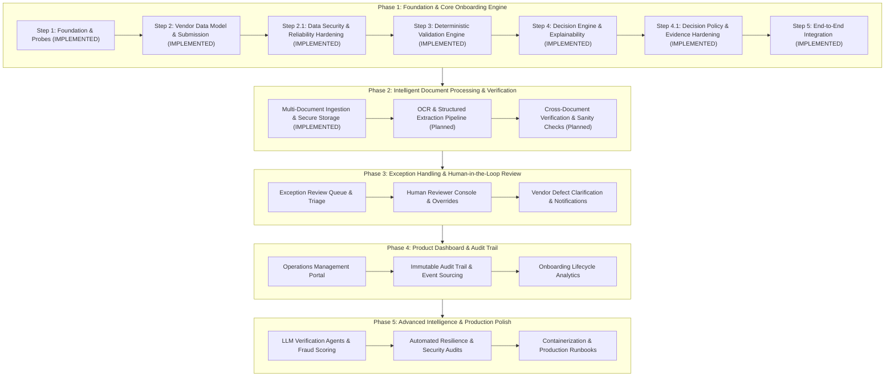

# Zamp AI Solutions Analyst Case Study
## Architecture Design Document — Vendor Onboarding Automation

**Author:** Lead Software Engineer  
**Version:** 2.5.0 (Phase 2 — Step 5 Cross-Document Validation & Discrepancy Detection)  
**Status:** Approved & Implemented Foundation, Security Hardening, Deterministic Validation, Decision Engine, End-to-End Integration, Document Intake, Storage Hardening, Document Classification, OCR Structured Information Extraction, Evidence Quality Scoring, Cross-Document Validation, Discrepancy Detection, & Operational Readiness  

---

## 1. Executive Summary & Objective

The **Zamp Vendor Onboarding Automation** platform is an intelligent, automated system designed to ingest, process, validate, and adjudicate vendor onboarding submissions. A vendor onboarding submission entails:
1. **Company Information:** Legal entity name, country of incorporation, registration/tax numbers (EIN/VAT/GST), and registered addresses.
2. **Banking Information:** Beneficiary name, IBAN / account numbers, SWIFT/BIC codes, routing details, and currency designations.
3. **Tax & Regulatory Details:** Tax forms (e.g., W-9, W-8BEN-E, VAT certificates) and compliance classifications.
4. **Supporting Documents:** Scanned PDFs/images of bank statements, certificates of incorporation, proof of address, and signatory authorizations.

The target system is built to autonomously parse multi-source data, cross-validate field consistency (e.g. matching legal company name on tax forms vs. bank statement vs. web form), detect anomalies, generate an explainable decision (**Approved / Pending / Rejected**), and communicate deficiencies to vendors or flag ambiguous submissions to human compliance reviewers.

This architecture has been designed from day one to scale through five progressive phases while avoiding premature complexity and preventing costly architectural refactoring.

---

## 2. Technology Selection & Driver Requirements

| Layer | Selected Technology | Alternative Considered | Justification & Driver Requirements |
| :--- | :--- | :--- | :--- |
| **Frontend Framework** | **React 18 + TypeScript** | Next.js, Vue 3 | React with TypeScript provides industry-standard stability, compile-time type safety across complex vendor state trees, strong UI ecosystem, and fast client-side rendering. For an operational workflow portal, a Vite-backed SPA avoids server-side rendering (SSR) overhead and edge runtime constraints. |
| **Styling** | **Tailwind CSS** | Material UI, CSS Modules | High-velocity development, zero runtime style overhead, predictable layout control, and unified design token primitives suitable for high-density enterprise review consoles. |
| **Backend Framework** | **Python (FastAPI) + Uvicorn** | Node.js (Express/Nest), Go | FastAPI offers native async performance, automatic OpenAPI/Swagger documentation generation (`/docs`), strict data validation with Pydantic v2, and direct first-class compatibility with the Python AI/ML ecosystem (LangChain, LlamaIndex, PyMuPDF, OCR engines, Gemini/OpenAI SDKs). |
| **Validation Engine** | **Modular Rule Engine (`app/validation/`)** | JSONSchema, Cerberus | Pure, deterministic rule-based evaluation architecture. Decouples rule definitions from orchestration, collects all findings without short-circuiting, produces reproducible ordering, and supports dynamic configuration and severity overrides without database dependencies. |
| **Data Validation** | **Pydantic v2 + pydantic-settings** | Marshmallow, Cerberus | Native FastAPI integration, high-speed C-based core (`pydantic-core`), explicit schemas for API request/response contracts, and fail-fast environment variable validation. |
| **Persistence / ORM** | **SQLAlchemy 2.0** | Raw SQL, Tortoise ORM | Modern typing, complete database-agnostic abstraction, Unit of Work and Repository pattern support, and clean migration paths. |
| **Database Engine** | **SQLite (Active Dev) / PostgreSQL (Production Target)** | MongoDB, DynamoDB | Relational integrity is mandatory for compliance, vendor state machines, and relational audit logging. **SQLite is the currently active and fully installed driver** (`sqlite3` standard library), providing zero-dependency local development and predictable absolute path resolution. **PostgreSQL is supported via configuration interface** (`DATABASE_URL`), but running against PostgreSQL requires installing a compatible production DBAPI driver (such as `psycopg2-binary` or `asyncpg`). |
| **Data Encryption at Rest** | **Fernet (`cryptography==50.0.2`)** | Raw AES-GCM, SQLite Encryption Extension (SEE) | Industry-standard authenticated symmetric encryption (AES-128-CBC + PKCS7 padding + HMAC-SHA256 signature). Eliminates cryptographic implementation flaws, prevents ciphertext tampering, and stores structured versioned tokens (`enc:v1:<token>`). |
| **Icons & Design** | **Lucide React** | Heroicons, FontAwesome | Modern, lightweight, customizable SVG iconography. Dependency pre-bundling is explicitly configured in `vite.config.ts` to prevent module transformation waterfalls. |

---

## 3. High-Level System Architecture

The application adopts a **Modular Monolith** architecture. Microservices are deliberately avoided to eliminate distributed systems complexity, network latency, distributed transactions, and infrastructure maintenance within the case-study timeframe.

```
+-----------------------------------------------------------------------------------+
|                                PRESENTATION TIER                                  |
|                                                                                   |
|  React 18 + TypeScript (Vite + Tailwind CSS)                                      |
|  +-------------------------+  +-------------------------+  +--------------------+ |
|  | Vendor Intake Portal    |  | Compliance Review Ops   |  | Audit Trail & Logs | |
|  | - Pre-submission check |  | - Live record validation|  |                    | |
|  | - Interactive findings  |  | - Accurate security     |  |                    | |
|  | - Accidental burst lock |  |   disclosure badge      |  |                    | |
|  +-------------------------+  +-------------------------+  +--------------------+ |
+------------------------------------------+----------------------------------------+
                                           | HTTP / REST (JSON)
                                           v
+-----------------------------------------------------------------------------------+
|                                  API GATEWAY TIER                                 |
|                                                                                   |
|  FastAPI Routing & Lifecycle (`backend/app/api/`)                                 |
|  +-----------------------------------------------------------------------------+  |
|  | Operational Probes: /healthz (Liveness) | /readyz (Readiness)                |  |
|  | Validation Endpoints: POST /vendors/validate | POST /vendors/{id}/validate  |  |
|  | Diagnostic API: /api/v1/health (Frontend Status)                             |  |
|  | Startup Lifespan: Fail-fast validation of DB connectivity & encryption key   |  |
|  | CORS Middleware | Pydantic Request Validation                               |  |
|  +-----------------------------------------------------------------------------+  |
+------------------------------------------+----------------------------------------+
                                           |
                                           v
+-----------------------------------------------------------------------------------+
|                              BUSINESS / SERVICE TIER                              |
|                                                                                   |
|  Decoupled Pure Domain Logic (`backend/app/services/` & `app/validation/`)        |
|  +-------------------------+ +-------------------------+ +----------------------+ |
|  | Vendor Intake Service   | | Validation Engine       | | Document OCR & Store | |
|  | - Explicit rollback     | | - Required field rules  | | (Planned Phase 2)    | |
|  | - At-rest encryption    | | - Format rules (tax/rt) | |                      | |
|  | - Deterministic sort    | | - Consistency rules     | |                      | |
|  +-------------------------+ +-------------------------+ +----------------------+ |
|  +-------------------------+ +-------------------------+ +----------------------+ |
|  | Decision Engine         | | Human Review Service    | | Audit Logging Service| |
|  | (Planned Step 4)        | | (Planned Phase 3)       | | (Planned Phase 4)    | |
|  +-------------------------+ +-------------------------+ +----------------------+ |
+------------------------------------------+----------------------------------------+
                                           |
                                           v
+-----------------------------------------------------------------------------------+
|                              SECURITY & PERSISTENCE TIER                          |
|                                                                                   |
|  SQLAlchemy 2.0 + Cryptography Engine (`backend/app/core/security.py`)            |
|  +-------------------------------------+ +--------------------------------------+ |
|  | Fernet Authenticated Encryption     | Deterministic SQLite (Dev)           | |
|  | Format: enc:v1:<fernet_token>       | PostgreSQL (Prod Target w/ Driver)   | |
|  | Key: VENDOR_DATA_ENCRYPTION_KEY     | Non-destructive migration utilities  | |
|  +-------------------------------------+ +--------------------------------------+ |
+-----------------------------------------------------------------------------------+
```

---

## 4. Health-Check & Operational Probes Architecture

To comply with enterprise operations and container orchestrator standards (e.g. Kubernetes, ECS, Cloud Run), the backend implements two clearly distinguished probes alongside a diagnostic endpoint:

1. **Liveness Probe (`GET /healthz`):**
   - **Purpose:** Verifies that the FastAPI process is alive, the event loop is responsive, and HTTP traffic can be accepted.
   - **Status Code:** `200 OK`
   - **Payload:** `{"status": "alive"}`
   - **Behavior:** Does NOT touch backing infrastructure (e.g., database) to prevent cascading container restarts during transient dependency degradation.

2. **Readiness Probe (`GET /readyz`):**
   - **Purpose:** Verifies whether critical downstream dependencies (specifically the database) are healthy and ready to serve live traffic.
   - **Status Code:** `200 OK` when database responds to `SELECT 1`; `503 Service Unavailable` when database connectivity is degraded.
   - **Payload:**
     ```json
     // Healthy (200 OK):
     {"status": "ready", "dependencies": {"database": "connected"}}

     // Degraded (503 Service Unavailable):
     {"status": "not_ready", "dependencies": {"database": "disconnected"}}
     ```

3. **Frontend Diagnostic Endpoint (`GET /api/v1/health`):**
   - **Purpose:** Retained under API versioning for frontend UI diagnostic widgets, environment indicators, and version tracking.
   - **Semantics:** Semantically consistent with readiness (returns `200 OK` when database is healthy; `503 Service Unavailable` when degraded).

---

## 5. Security & Reliability Architecture

### A. Bank Account Number Authenticated Encryption at Rest
Financial account numbers are sensitive financial data that must never be persisted in plaintext.
1. **Cryptographic Algorithm:** Fernet symmetric encryption from `cryptography==50.0.2` (AES-128-CBC + PKCS7 padding + HMAC-SHA256 authenticated integrity).
2. **Versioned Storage Format:** Stored with an explicit version prefix `enc:v1:<fernet_token>`.
3. **Fail-Safe Startup Verification:** During `lifespan()`, `get_fernet_cipher()` verifies `VENDOR_DATA_ENCRYPTION_KEY`. If absent or malformed, the application aborts startup immediately with `RuntimeError`.
4. **Data Protection In-Flight & In API Responses:** Raw account numbers are decrypted in memory strictly when required for validation structural length checks or response masking, and immediately discarded. Never emitted in API payloads, logs, or exceptions.

---

## 6. Deterministic Validation Engine Architecture (Step 3)

The validation engine resides in `backend/app/validation/` and operates as a decoupled, deterministic subsystem.

```text
backend/app/validation/
├── __init__.py           # Package exports
├── config.py             # ValidationConfig & ruleset versioning
├── engine.py             # ValidationEngine orchestrator
├── models.py             # Structured result, summary & finding models
├── registry.py           # RuleRegistry & default rule catalog
└── rules/
    ├── base.py           # ValidationRule abstract base class
    ├── required.py       # Mandatory-field rules
    ├── formats.py        # Format rules (email, phone, tax ID, routing, account)
    └── consistency.py    # Cross-field consistency rules
```

### A. Core Design Principles
1. **Separation of Validation from Decisioning:**
   The engine performs **verification of syntax, completeness, and consistency**. It does **NOT** issue business decisions (`Approved` or `Rejected`) or mutate vendor status (which belongs to Step 4).
2. **Deterministic Output & Reproducibility:**
   Rules execute in a strictly defined category order (`required` $\to$ `format` $\to$ `consistency`). Findings are deterministically sorted by `Severity (ERROR -> WARNING -> INFO)` $\to$ `field` $\to$ `rule_id` $\to$ `code`.
3. **Exhaustive Evaluation (No Short-Circuiting):**
   All applicable rules are evaluated across the entire payload. The engine collects all errors, warnings, and informational notes in a single run.
4. **Zero Mutation & Zero Sensitive Leakage:**
   Input payloads are copied without modifying the caller's objects. Raw account numbers and credentials never appear in finding messages or suggestions.

### B. Severity Semantics & Outcome Mapping
Each finding carries a severity:
- `ERROR`: Violation of a mandatory statutory requirement, syntax rule, or checksum. Prevents a submission from being considered valid.
- `WARNING`: Discrepancy or unusual pattern (e.g., entity name vs. bank account holder mismatch, cross-jurisdiction routing) that warrants review or documentation, but does not strictly invalidate data syntax.
- `INFO`: Informational note regarding multinational operations or unsupported tax regimes.

**Outcome Status Semantics:**
- `PASSED`: Zero `ERROR` findings and zero `WARNING` findings (`valid: true`).
- `PASSED_WITH_WARNINGS`: Zero `ERROR` findings, but at least one `WARNING` finding (`valid: true`).
- `FAILED`: One or more `ERROR` findings (`valid: false`).

### C. Supported Jurisdictions & Rule Specifications

1. **Required Fields (19 Mandatory Attributes):**
   - Company: `legal_name`, `business_type`, `country_of_incorporation`, `registration_number`.
   - Contact: `contact_name`, `contact_email`, `contact_phone`.
   - Address: `address_line1`, `city`, `state_province`, `postal_code`, `address_country`.
   - Tax: `tax_id_type`, `tax_id_number`.
   - Banking: `bank_account_holder_name`, `bank_name`, `bank_account_number`, `bank_routing_number`, `bank_country`.
   - *Optional:* `trade_name`, `address_line2` (never fail required checks).

2. **Format Validation Rules:**
   - **Email (`FMT_EMAIL_STRUCTURE`):** RFC 5322 syntax validation.
   - **Phone (`FMT_PHONE_INTERNATIONAL`):** International structural check (7–17 digits, optional `+` and separators). Does not claim reachability.
   - **India GSTIN (`FMT_TAX_ID_SYNTAX`):** 15-character statutory regex (`^[0-9]{2}[A-Z]{5}[0-9]{4}[A-Z]{1}[1-9A-Z]{1}Z[0-9A-Z]{1}$`).
   - **India PAN (`FMT_TAX_ID_SYNTAX`):** 10-character statutory regex (`^[A-Z]{5}[0-9]{4}[A-Z]{1}$`).
   - **US EIN (`FMT_TAX_ID_SYNTAX`):** 9-digit format (`^[0-9]{2}-?[0-9]{7}$`) with validation against unassigned IRS campus prefixes (`00`, `07`, `08`, `09`, etc.).
   - **UK VAT (`FMT_TAX_ID_SYNTAX`):** Standard 9-digit or 12-digit branch UK VAT numbers (`^(?:GB)?\s*([0-9]{9}|[0-9]{12})$`).
   - **India IFSC (`FMT_BANK_ROUTING`):** 11 characters (`^[A-Z]{4}0[A-Z0-9]{6}$`).
   - **US ABA Routing (`FMT_BANK_ROUTING`):** 9 numeric digits validated against the Federal Reserve Mod-10 weighting algorithm:
     $$[3(d_1 + d_4 + d_7) + 7(d_2 + d_5 + d_8) + 1(d_3 + d_6 + d_9)] \pmod{10} = 0$$
   - **SWIFT/BIC (`FMT_BANK_ROUTING`):** 8 or 11 characters (`^[A-Z]{4}[A-Z]{2}[A-Z0-9]{2}(?:[A-Z0-9]{3})?$`).
   - **Bank Account Structural (`FMT_BANK_ACCOUNT_STRUCTURAL`):** Length between 6 and 34 characters; rejects repeated dummy sequences (e.g. `00000000`) or ascending runs (`12345678`).

3. **Consistency Rules:**
   - **Tax Type vs. Country (`CONST_TAX_TYPE_COUNTRY`):** Flags mismatch (e.g. GSTIN/PAN outside India, EIN outside US, VAT in US) as `WARNING`.
   - **Routing vs. Bank Country (`CONST_ROUTING_BANK_COUNTRY`):** Flags IFSC outside India or ABA outside US as `WARNING`.
   - **Cross-Border Setup (`CONST_CROSS_BORDER_REGISTRATION`):** Emits an `INFO` note when incorporation country differs from registered address country.
   - **Account Holder Matching (`CONST_ACCOUNT_HOLDER_MATCH`):** Compares normalized token overlap between account holder name and legal/trade name. Mismatch emits a `WARNING`.

4. **Unsupported Validation Regimes:**
   When a tax regime or routing scheme is not among the initial certified sets (e.g. Australian ABN or Canadian transit numbers), the engine emits a clear `INFO` finding (`TAX_FORMAT_UNSUPPORTED_NOTE`) rather than inventing arbitrary validation rules.

### D. How to Add a New Rule
1. Subclass `ValidationRule` in `backend/app/validation/rules/`.
2. Define `rule_id`, `name`, `description`, `default_severity`, `target_fields`, and `category`.
3. Implement `validate(self, data, context, config) -> List[ValidationFinding]`.
4. Register the rule in `backend/app/validation/registry.py` under `create_default_registry()`.

### E. Validation API Endpoints
- `POST /api/v1/vendors/validate`: Evaluates an unsaved vendor payload (complete or partial) without database interaction.
- `POST /api/v1/vendors/{vendor_id}/validate`: Loads an existing vendor, decrypts banking information in memory solely for structural validation, and evaluates the record without modifying vendor status or writing to the database.

---

## 7. Deterministic Decision Engine & Policy Hardening Architecture (Step 4 & Step 4.1)

The decision engine resides in `backend/app/decision/` and orchestrates deterministic onboarding decisions from validation findings.

```text
backend/app/decision/
├── __init__.py           # Package exports
├── config.py             # DecisionConfig, DEFAULT_RULE_ACTIONS, verify_registry_coverage()
├── engine.py             # DecisionEngine orchestrator & outcome calculation
├── models.py             # Pydantic schemas (DecisionResult, DecisionReason, DecisionRecommendation)
├── registry.py           # Engine singleton instance
└── rules.py              # Explainable reason mappers & sanitized recommendation generators
```

### A. Tri-State Decision Semantics
1. **`APPROVED`:** All deterministic mandatory fields, statutory formats, and consistency rules are satisfied without blocking errors or unresolved review items.
   *Important:* An `APPROVED` outcome indicates that configured deterministic checks passed. It does NOT assert official government tax registration or verify bank account ownership with third-party banking APIs.
2. **`PENDING`:** The vendor record requires review, clarification, or additional information before onboarding can proceed. Triggered by missing mandatory submission fields or cross-field consistency discrepancies.
3. **`REJECTED`:** The vendor violated a configured statutory syntax rule, invalid checksum, or placeholder banking sequence (e.g. malformed GSTIN, failed US ABA Mod-10 checksum, dummy bank account).

### B. Core Finding Classifications & Policy Mapping

| Classification | Validation Finding Examples | Decision Action | Resulting Decision Status | Operational Rationale |
| :--- | :--- | :--- | :--- | :--- |
| **Incomplete Information** | All 19 missing mandatory fields (`COMPANY_LEGAL_NAME_REQUIRED`, `BANK_ACCOUNT_NUMBER_REQUIRED`, etc.) | `DecisionAction.REVIEW` | **`PENDING`** | Missing or incomplete fields do not constitute conclusive evidence of ineligibility or fraud. Actionable recommendations prompt the vendor to provide the missing mandatory values (`PROVIDE_LEGAL_NAME`, etc.). |
| **Invalid Structural Information** | Malformed GSTIN/PAN/EIN syntax, failed ABA Mod-10 checksum, invalid IFSC, dummy account sequence | `DecisionAction.BLOCK` | **`REJECTED`** | Concrete structural or statutory violations representing invalid or unusable financial/tax coordinates. |
| **Review-Required Inconsistencies** | Bank account holder name mismatch, tax scheme mismatch with jurisdiction, domestic routing code outside domicile country | `DecisionAction.REVIEW` | **`PENDING`** | Discrepancies warrant human compliance review and supporting documentation (e.g. DBA explanation, parent entity relationship) rather than outright rejection. |
| **Informational Notes** | Cross-border operations note, unsupported foreign tax regime note | `DecisionAction.IGNORE` | **`APPROVED`** *(if no blockers)* | Operational notes that document multinational posture without impeding onboarding approval. |
| **Technical Integrity Failures** | Corrupted ciphertext (`enc:v1:...`), absent/invalid encryption key | **Abort Execution** | **`HTTP 500 Error`** | Technical failures must NEVER be converted into business findings (e.g. treating failed decryption as a "missing account number"). The engine aborts with zero mutation to `vendor.status` or `vendor.updated_at` and creates zero decision records. |

### C. Resolution Precedence Hierarchy
Configuration precedence is strictly enforced:
1. **Explicit finding code override** (`self.finding_code_actions`): Highest precedence for granular code rules.
2. **Explicit rule ID mapping** (`self.rule_actions`): Mapped across all 28 validation registry rules.
3. **Documented severity fallback** (`default_error_action -> BLOCK`, `default_warning_action -> REVIEW`, `default_info_action -> IGNORE`).

Full registry coverage is programmatically verified using `DecisionConfig.verify_registry_coverage(default_registry)`.

### D. Explanation Sanitization & Sensitive Data Privacy
- **Zero Raw Value Echoing:** Decision reasons and recommendations do not echo user-provided raw values. For example, `ACCOUNT_HOLDER_NAME_MISMATCH` generates: *"The bank account holder name does not sufficiently match the registered company or trade name."* without reflecting raw submitted entity names.
- **Zero Sensitive Banking Data:** Plaintext account numbers, Fernet ciphertexts, tax IDs, and passwords are strictly excluded from persisted `validation_snapshot`, decision explanations, and logs.

### E. Transactional Consistency & Append-Only Audit History
- A decision execution inserts a new `VendorDecision` record and updates `Vendor.status` atomically in the same database transaction (`db.commit()`).
- If an error occurs at any point, both operations are rolled back completely (`db.rollback()`).
- Decision history is strictly append-only, preserving an auditable trail of all evaluations.

---

## 8. End-to-End Integration & Lifecycle Mechanics (Step 5)

Phase 1 Step 5 connects intake, persistence, validation, decisioning, profile updates, and audit history into a cohesive operational workflow:

```
+----------------------------------------------------------------------------------------------------+
|                                    END-TO-END LIFECYCLE FLOW                                       |
|                                                                                                    |
|  [Vendor Intake UI]                                                                                |
|          |                                                                                         |
|          v POST /api/v1/vendors                                                                    |
|  [Vendor Model + Fernet Encryption] --------> [VendorActivity: VENDOR_SUBMITTED]                   |
|          |                                                                                         |
|          +------------------------------------+                                                    |
|          | (On-Demand Dry-Run)                | (Authoritative Decision)                           |
|          v POST /vendors/{id}/validate        v POST /vendors/{id}/decide                          |
|  [Validation Engine Execution]        [Decision Engine Policy Mapping]                             |
|          | (In-Memory Decryption)             |                                                    |
|          v                                    +---> [vendor_decisions Audit Snapshot]              |
|  [Validation Findings Summary]                +---> [Vendor.status = APPROVED | PENDING | REJECTED]|
|  (Zero Status Mutation)                       +---> [VendorActivity: DECISION_EXECUTED]            |
|                                               |                                                    |
|                                               v                                                    |
|                                    [Vendor Detail Modal]                                           |
|                                    - Decision Banner & Recommendations                             |
|                                    - Activity History Timeline                                     |
|                                    - Edit / Correct Profile Mode                                   |
|                                               |                                                    |
|                                               v PUT /api/v1/vendors/{id}                           |
|                                    [Encrypted Attribute Update]                                    |
|                                               |                                                    |
|                                               +---> [VendorActivity: VENDOR_UPDATED]               |
|                                               v                                                    |
|                                    [Re-evaluate Decision: POST /decide]                            |
|                                               |                                                    |
|                                               +---> [Append New Decision to History]               |
|                                               +---> [Vendor.status = APPROVED]                     |
|                                               +---> [VendorActivity: DECISION_REEVALUATED]         |
+----------------------------------------------------------------------------------------------------+
```

### A. Dual-History Architecture
To address distinct operational and regulatory requirements without architectural pollution, the platform implements two decoupled historical persistence models:
1. **Decision Audit History (`vendor_decisions`):**
   - **Entity:** `VendorDecision` (`models/decision.py`)
   - **Scope:** Immutable compliance record generated strictly by the decision engine.
   - **Payload:** Serialized validation findings (`validation_snapshot`), stable programmatic reason codes (`reason_codes`), human-readable explanations, and prioritized next-step recommendations.
   - **Security Guarantee:** Evaluated validation findings are sanitized; raw banking account numbers and encryption tokens are strictly excluded.
2. **Lifecycle Execution History (`vendor_activities`):**
   - **Entity:** `VendorActivity` (`models/activity.py`)
   - **Scope:** Chronological operational event feed tracking discrete lifecycle actions.
   - **Payload:** `event_type` (`VENDOR_SUBMITTED`, `DECISION_EXECUTED`, `VENDOR_UPDATED`, `DECISION_REEVALUATED`), title, safe description, and resulting status.
   - **Security Guarantee:** Activity descriptions never echo raw bank accounts, tax IDs, or cryptographic tokens.

### B. Safe Technical Error Handling (Decryption Hardening)
- Across all inspection and decision endpoints (`POST /vendors/{id}/validate`, `POST /vendors/{id}/decide`), cryptographic and decryption failures are caught explicitly.
- In the event of ciphertext corruption or missing keys, the endpoint halts immediately with `HTTP 500 Internal Server Error` without mutating database state.
- Crucially, cryptographic failures are **never** swallowed or converted into false "missing field" validation findings.

### C. Synthetic Demonstration Data Seeder
- Managed via `backend/app/scripts/seed_demo_data.py`.
- Generates 4 realistic vendors matching all 4 core business scenarios:
  - Clean Indian vendor submission $\rightarrow$ `APPROVED`
  - Incomplete vendor submission (missing registration & phone) $\rightarrow$ `PENDING`
  - Name discrepancy (account holder vs. legal entity) $\rightarrow$ `PENDING`
  - Blocking statutory syntax error (malformed GSTIN) $\rightarrow$ `REJECTED`
- Supports `--reset` for isolated cleanup without affecting real vendor records, and `--no-decisions` for initial intake state demonstration.

---

## 9. Five-Phase Implementation Roadmap

Boundaries are strictly maintained between completed steps and planned future modules:



### Module Status Summary

| Module | Phase | Status | Location |
| :--- | :--- | :--- | :--- |
| **Application Runtime & Probes** | Phase 1 (Step 1) | **Implemented** | `backend/app/main.py` (`/healthz`, `/readyz`) |
| **Deterministic DB Engine & Base** | Phase 1 (Step 1) | **Implemented** | `backend/app/db/base.py`, `backend/app/db/session.py` |
| **Frontend Application Shell** | Phase 1 (Step 1) | **Implemented** | `frontend/src/App.tsx`, `frontend/src/components/` |
| **Vendor Submission & Profile** | Phase 1 (Step 2) | **Implemented** | `backend/app/models/vendor.py`, `backend/app/services/vendor_service.py`, `backend/app/api/v1/endpoints/vendors.py` |
| **Data Encryption & Reliability Hardening** | Phase 1 (Step 2.1) | **Implemented** | `backend/app/core/security.py`, `backend/app/db/migrate_encryption.py`, `backend/tests/test_security_and_reliability.py` |
| **Deterministic Validation Engine** | Phase 1 (Step 3) | **Implemented** | `backend/app/validation/`, `backend/tests/test_validation_*.py` |
| **Decision Engine (Approved/Pending/Rejected)** | Phase 1 (Step 4) | **Implemented** | `backend/app/decision/`, `backend/app/services/decision_service.py` |
| **Decision Policy & Evidence Hardening** | Phase 1 (Step 4.1) | **Implemented** | `backend/app/decision/config.py`, `backend/app/decision/rules.py`, `backend/app/services/decision_service.py` |
| **End-to-End Core Integration & Activity History** | Phase 1 (Step 5) | **Implemented** | `backend/app/api/v1/endpoints/vendors.py`, `backend/app/models/activity.py`, `backend/app/scripts/seed_demo_data.py`, `frontend/src/components/VendorActivityTimeline.tsx` |
| **Document Intake & Secure Storage** | Phase 2 (Step 1 & 1.1) | **Implemented** | `backend/app/models/document.py`, `backend/app/core/storage.py`, `backend/app/core/document_validator.py`, `backend/app/services/document_service.py`, `backend/app/api/v1/endpoints/documents.py`, `frontend/src/components/DocumentManager.tsx` |
| **Document Classification Engine** | Phase 2 (Step 2 & 2.1) | **Implemented** | `backend/app/classification/`, `backend/app/services/classification_service.py` |
| **OCR & Structured Information Extraction** | Phase 2 (Step 3) | **Implemented** | `backend/app/extraction/ocr_engine.py`, `backend/app/extraction/parsers.py`, `backend/app/services/extraction_service.py` |
| **Extraction Confidence & Evidence Management** | Phase 2 (Step 4) | **Implemented** | `backend/app/extraction/confidence.py`, `backend/app/extraction/normalization.py`, `backend/app/api/v1/endpoints/documents.py`, `frontend/src/components/DocumentManager.tsx` |
| **Cross-Document Verification** | Phase 2 (Step 5) | *Planned* | `backend/app/services/cross_doc_service.py` |
| **Human-in-the-Loop Review** | Phase 3 | *Planned* | `backend/app/services/review_service.py` |
| **Audit Trail & Logging** | Phase 4 | *Planned* | `backend/app/services/audit_service.py` |
| **LLM Verification Agents** | Phase 5 | *Planned* | `backend/app/services/ai_agent_service.py` |

---

## 10. Phase 2 — Step 1: Document Intake & Secure Storage Architecture

Phase 2, Step 1 establishes the enterprise document foundation for vendor compliance artifacts (tax certificates, proof of banking, certificates of incorporation, and address verification).

### A. Core Architectural Tenets & Scope Boundaries
- **Strict Intake Foundation:** Focuses solely on safe binary upload, validation, secure storage, authenticated retrieval, and metadata management.
- **Explicit Scope Restrictions:** Strictly defers OCR text extraction, layout analysis, automated document classification, cross-document comparison, and automated decision changes to subsequent Phase 2 steps.
- **Defense in Depth:** Files are never stored under public webroots, paths cannot be manipulated via traversal attacks, binary contents are verified against magic byte signatures, and files at rest are cryptographically encrypted.

### B. Relational Data Model (`vendor_documents`)
The `VendorDocument` model (`backend/app/models/document.py`) cleanly separates public metadata from physical storage tokens:
- `id`: UUID (Primary Key).
- `vendor_id`: Foreign key to `vendors.id` (with `ON DELETE CASCADE` and ORM `cascade="all, delete-orphan"`).
- `original_filename`: Client-supplied filename (e.g. `Tax_Return_2024.pdf`).
- `sanitized_filename`: Normalized, path-traversal-stripped filename.
- `document_category`: Enumerated category (`CERTIFICATE_OF_INCORPORATION`, `TAX_CERTIFICATE`, `BANK_PROOF`, `ADDRESS_PROOF`, `OTHER`, `UNKNOWN`).
- `mime_type`: Normalized MIME type (`application/pdf`, `image/png`, `image/jpeg`).
- `file_extension`: Extracted extension (`.pdf`, `.png`, `.jpg`, `.jpeg`).
- `file_size_bytes`: Integer byte count.
- `storage_identifier`: Opaque, non-enumerable physical storage key (`{vendor_id}/{document_id}.enc`). Strictly excluded from all public API responses and frontend views.
- `sha256_checksum`: Hexadecimal SHA-256 hash of original plaintext binary for cryptographic integrity verification.
- `upload_status`: Lifecycle status (`UPLOADED`, `PROCESSING`, `PROCESSED`, `FAILED`).
- `document_version`: Monotonically incrementing integer version per `(vendor_id, document_category)`.
- `created_at` / `updated_at`: UTC timestamps.

### C. Secure Document Storage Abstraction (`DocumentStorage`)
Physical storage operations are encapsulated in `backend/app/core/storage.py`:
- **Directory Isolation:** Files are written to an isolated storage root (`data/documents/`) resolved deterministically outside webroots.
- **Path Traversal Prevention:** Storage paths enforce strict lexical containment via `path.resolve().relative_to(root)`. Any path traversal (`../`) is rejected with `StoragePathTraversalError`.
- **Authenticated Encryption at Rest:** Files are encrypted using symmetric Fernet encryption (AES-128-CBC + HMAC-SHA256 authenticated envelope). Plaintext files are never written to disk. The cryptographic key is derived from `DOCUMENT_ENCRYPTION_KEY` or falls back safely to `VENDOR_DATA_ENCRYPTION_KEY`.
- **Atomic Disk Writes:** New files are written to `.tmp` files and flushed to disk before atomic rename to their target path, preventing partial or corrupt uploads.
- **Transactional Rollback:** If database persistence fails during intake, the physical file on disk is removed immediately to prevent orphaned storage.

### D. Multi-Layer Upload Validation (`document_validator.py`)
Incoming uploads undergo multi-tiered defense before encryption or persistence:
1. **Size Enforcement:** Files exceeding `10 MB` (`10,485,760` bytes) or empty files (`0` bytes) are rejected with `HTTP 413` or `HTTP 400`.
2. **Extension Whitelist:** Only `.pdf`, `.png`, `.jpg`, and `.jpeg` are allowed. Dangerous extensions (`.exe`, `.sh`, `.php`, `.js`, etc.) are blocked.
3. **Magic Byte Signature Inspection:** Uploads are inspected for byte-level binary signatures:
   - PDF: `%PDF-` (`0x25 0x50 0x44 0x46 0x2D`)
   - PNG: `\x89PNG\r\n\x1a\n` (`0x89 0x50 0x4E 0x47 0x0D 0x0A 0x1A 0x0A`)
   - JPEG: `\xFF\xD8\xFF`
   Mismatched declared MIME types vs. detected binary headers are rejected with `HTTP 400`.
4. **Filename Sanitization:** Path delimiters (`/`, `\`), null bytes (`\0`), and directory traversal markers (`..`) are stripped, producing safe identifiers.

### E. Document REST API Endpoints
- `POST /api/v1/vendors/{vendor_id}/documents`: Multipart upload accepting `file` and `document_category`. Returns `201 Created` with `VendorDocumentResponse`.
- `GET /api/v1/vendors/{vendor_id}/documents`: Paginated document list with optional `?category=` filtering.
- `GET /api/v1/vendors/{vendor_id}/documents/{document_id}`: Document metadata inspection.
- `GET /api/v1/vendors/{vendor_id}/documents/{document_id}/content`: Authenticated decrypted binary stream with `Content-Disposition: attachment; filename="<sanitized>"` and `X-Content-Type-Options: nosniff`.
- `DELETE /api/v1/vendors/{vendor_id}/documents/{document_id}`: Deletes metadata and physically purges encrypted ciphertext from disk (`204 No Content`).

### F. Lifecycle Audit Activity Integration
Document mutations automatically append events to the `VendorActivity` timeline:
- **`DOCUMENT_UPLOADED`:** Records filename, category, and formatted size.
- **`DOCUMENT_DELETED`:** Records document removal without leaking storage keys or cryptographic parameters.

---

## 11. Phase 2 — Step 1.1: Document Storage Resource & Lifecycle Hardening

Phase 2, Step 1.1 hardens the document intake and storage subsystem against resource exhaustion, symlink directory escapes, and split-brain states during deletion.

### A. Bounded Upload Stream Processing
- **Chunked Reading (`read_upload_file_bounded`):** Replaced monolithic in-memory reads (`await file.read()`) with bounded 64 KB chunked streaming up to `MAX_DOCUMENT_FILE_SIZE_BYTES` (10 MB).
- **Fail-Fast Early Termination:** As soon as accumulated bytes exceed the configured size boundary, reading immediately aborts and raises `DocumentSizeExceededError` (mapped to `HTTP 413 Payload Too Large`). The remaining payload is discarded without buffering into memory.
- **Guaranteed Resource Disposal:** Uses `try ... finally: await file.close()` to guarantee that temporary upload file handles and SpooledTemporaryFile backing stores are immediately reclaimed.
- **Strict Content-Length Invalidation:** Does not trust spoofable client `Content-Length` headers; streaming byte counts are strictly validated in real time.

### B. Hardened Path Containment & Symlink Defense
- **Canonical Two-Part Segment Layout:** Enforces strict relative structure `<vendor_id>/<document_id>.enc` (and `.deleted` / `.tmp`).
- **UUID Format Validation:** Both the vendor directory segment and document file stem must be valid RFC 4122 UUID strings, preventing arbitrary naming and shell injection attempts.
- **Token & Traversal Rejection:** Null bytes (`\x00`), backslashes (`\`), path traversal tokens (`..`, `.`), and absolute paths are rejected with `StoragePathTraversalError`.
- **Symlink Directory Containment:** Resolves real physical paths using `os.path.realpath` and validates strict containment via `Path.relative_to(storage_root)`. Traversal attempts through symlinks pointing outside the storage directory are trapped and rejected.
- **Information Disclosure Prevention:** Storage exceptions and API error responses never expose internal server directory paths (e.g. `/Users/...` or `/data/...`).

### C. Two-Phase Staged Deletion & Consistency Recovery
- **Safe Pre-Mutation Staging (`stage_deletion`):** Before database modification, the physical `.enc` file is atomically renamed to `.enc.deleted`.
- **Early Abort on Filesystem Failure:** If disk staging fails (e.g. permission error, unwritable media), the operation terminates immediately with `HTTP 500`. The database record is preserved, and no false `DOCUMENT_DELETED` activity log is emitted.
- **Atomic Rollback Recovery (`rollback_staged_deletion`):** If the database transaction (deleting `VendorDocument` and creating `VendorActivity`) fails or is rolled back, the staged `.deleted` file is atomically restored back to `.enc` on disk.
- **Finalized Physical Purge (`finalize_staged_deletion`):** Following database commit success, the staged file is permanently unlinked and empty vendor directories are cleaned up.
- **Idempotent Orphan Cleanup:** If a physical file is already absent on disk, deletion completes idempotently, allowing orphaned database records to be cleanly expunged.

---

## 12. Phase 2 — Step 2: Document Classification Engine & Explainability

Phase 2, Step 2 introduces a dedicated, explainable document classification engine to identify the compliance category of uploaded vendor documents from their contents.

### A. Architectural Separation of Classification
- **Domain Independence:** The classification subsystem (`backend/app/classification/`) is strictly decoupled from the deterministic vendor validation engine (`backend/app/validation/`) and the vendor decision engine (`backend/app/decision/`).
- **Explainable Predictions vs. Compliance Decisions:** The output of document classification is an explainable prediction with category confidence and safe evidence signals. It **never mutates or interacts with vendor-level onboarding status** (`APPROVED`, `PENDING`, `REJECTED`).
- **Declared vs. Predicted Preservation:** Uploaded documents retain the user's declared category as `declared_category`. The classifier predicts `predicted_category` and records differences without overwriting user input.

### B. Safe Internal Digital Text Extraction (`text_extractor.py`)
- **Digital PDF Extraction Only:** Uses `pypdf` to extract embedded text from digitally readable PDFs within strict bounds (up to the first 25 pages, capped at 50,000 characters).
- **Explicit Scanned Image Rejection (Zero OCR Hallucination):** In strict adherence to Step 2 boundaries, flat image uploads (PNG, JPEG) and textless PDFs do not run OCR. They immediately return `status="INSUFFICIENT_TEXT"` with explicit limitation codes (`IMAGE_ONLY_DOCUMENT` or `NO_EXTRACTABLE_TEXT`) and 0.0 confidence score.
- **Data Privacy Assurance:** Raw extracted document text and sensitive account/tax numbers are never persisted in the database or exposed in responses.

### C. Deterministic Scoring Model & Disambiguation (`rules.py`, `engine.py`)
- **Weighted Evidence Formulation:**
  - `CATEGORY_STRONG_HEADINGS`: Direct statutory headings contribute up to 0.70 toward category score.
  - `CATEGORY_CONTEXT_KEYWORDS`: Jurisdictional and compliance terms contribute up to 0.40.
  - `CATEGORY_FILENAME_SIGNALS`: Filename hints provide secondary evidence capped at 0.08. Filename matches alone can never classify a document without supporting text.
- **Confidence Tiers & Limitation Codes:**
  - $\ge 0.70$: `CLASSIFIED`
  - $0.40 - 0.70$: `LOW_CONFIDENCE`
  - $< 0.40$ or ambiguous: `LOW_CONFIDENCE` (`predicted_category="UNKNOWN"`)
  - Top two category scores within 0.15 margin when both $\ge 0.35$: `LOW_CONFIDENCE` (`limitation_code="CONFLICTING_SIGNALS"`)
  - Non-extractable text: `INSUFFICIENT_TEXT` (`limitation_code="NO_EXTRACTABLE_TEXT"` or `"IMAGE_ONLY_DOCUMENT"`)

### D. Audit Logging & REST API Contracts (`services/classification_service.py`)
- **`document_classifications` Table:** Stores each classification execution with foreign keys to `vendor_documents` and `vendors`, status, confidence, classifier version (`1.0.0`), and sanitized dictionary evidence.
- **Versioned History:** Running classification multiple times appends new rows to history while `VendorDocument.latest_classification` dynamically surfaces the most recent result.
- **Activity Timeline Integration:** Successful classification appends a `DOCUMENT_CLASSIFIED` event to `VendorActivity` timeline without changing vendor status.

---

## 13. Phase 2 — Step 3: OCR & Structured Information Extraction Pipeline

Phase 2, Step 3 implements an end-to-end, multi-format OCR and deterministic structured information extraction engine with field-level provenance and sensitive data protection.

### A. Core Architecture & Separation of Concerns
- **`app/extraction/ocr_engine.py`:** Handles document stream recognition:
  - **Digital PDF Extraction:** Directly extracts embedded text streams page-by-page via `pypdf`.
  - **Scanned PDF Rendering & OCR:** For rasterized or scanned PDFs with insufficient digital text, renders pages to images via `pdf2image` (`pdftoppm`) within strict dimension limits (`2500px`) and processes each page using local Tesseract OCR (`pytesseract`).
  - **Image Document OCR:** Processes standalone PNG and JPEG files using local Tesseract OCR with automatic image normalization.
  - **Bounded Processing Limits:** Enforces hard caps on pages (`MAX_PAGES_LIMIT = 10`), rendering resolution, per-page character lengths, and total document text to prevent DoS attacks.
- **`app/extraction/parsers.py` (`DocumentParser`):** Deterministic category-specific rule parsers:
  - Maps recognized text lines to structured field schemas for `TAX_CERTIFICATE`, `BANK_PROOF`, `CERTIFICATE_OF_INCORPORATION`, `ADDRESS_PROOF`, and fallback `OTHER`.
  - Extracts canonical key-value pairs without hallucinations or probabilistic guessing.
  - Generates explicit field-level provenance: original `page_number`, `extraction_method` (`DIGITAL_TEXT` vs `OCR`), exact `evidence_location` (e.g. `Page 1, Line 3`), and contextual `evidence_snippet`.
- **`app/schemas/extraction.py`:** Pydantic contracts for extraction data:
  - `FieldStatus`: `EXTRACTED`, `PARTIAL`, `MISSING`, `INSUFFICIENT_TEXT`, `FAILED`.
  - `ExtractionStatus`: `COMPLETED`, `PARTIAL`, `INSUFFICIENT_TEXT`, `FAILED`.
  - `ExtractionLimitationCode`: Standardized programmatic limitation reasons (`NO_READABLE_TEXT`, `IMAGE_RESOLUTION_LOW`, `ROTATED_OR_SKEWED`, `TRUNCATED_MAX_PAGES`, etc.).
  - `ExtractedField`: Typed representation of an extracted field including `value`, `masked_value`, `confidence`, and `source` (`FieldSource`).
- **`app/models/extraction.py` (`DocumentExtraction`):** SQLAlchemy ORM entity:
  - Stores extraction executions non-destructively in `document_extractions` table.
  - Maintains `ON DELETE CASCADE` relationship with `vendor_documents` so physical document deletion automatically cascades and purges associated extraction records.
- **`app/services/extraction_service.py` (`ExtractionService`):**
  - Manages secure in-memory document decryption, text recognition execution, deterministic field parsing, and database transactions.
  - Emits `DOCUMENT_EXTRACTED` event into `VendorActivity` timeline with field counts and safe metadata.
  - Strictly preserves vendor compliance state (`status` remains unchanged).

### B. Category-Specific Extraction Schemas
1. **`TAX_CERTIFICATE`:**
   - Fields: `gstin`, `legal_entity_name`, `registration_date`, `registered_address`, `taxpayer_type`.
   - Normalization: OCR character normalization for GSTINs (e.g. `O` $\leftrightarrow$ `0`), ISO 8601 date parsing (`YYYY-MM-DD`).
2. **`BANK_PROOF`:**
   - Fields: `bank_name`, `account_holder_name`, `account_number`, `ifsc_code`, `routing_number`, `account_type`.
   - Security: Sensitive account numbers are masked by default (`masked_value = "**********7890"`), preventing PII leakage in UI inspection, activity logs, and responses.
3. **`CERTIFICATE_OF_INCORPORATION`:**
   - Fields: `company_name`, `cin_or_reg_number`, `incorporation_date`, `registered_jurisdiction`.
4. **`ADDRESS_PROOF`:**
   - Fields: `resident_or_entity_name`, `full_address`, `issue_date`, `document_type`.
5. **`OTHER` / Fallback:**
   - Dynamic key-value extraction for detected identifier labels (`Tax ID`, `Account`, `Registration`, `Date`, `Address`).

### C. Missing Field Determinism (Zero Hallucination)
When a document lacks expected fields (such as a tax certificate with registration date or address omitted):
- The engine marks the field with status `FieldStatus.MISSING`.
- `value` is explicitly set to `None`.
- `limitation_or_reason` provides an unambiguous explanation (`"Field not detected in document content."`).
- Under no circumstances does the engine invent placeholder or synthetic data.

### D. REST API Endpoints
- `POST /api/v1/vendors/{vendor_id}/documents/{document_id}/extract`: Runs OCR/extraction and persists result.
- `GET /api/v1/vendors/{vendor_id}/documents/{document_id}/extraction`: Returns latest extraction and field provenance.
- `GET /api/v1/vendors/{vendor_id}/documents/{document_id}/extraction-history`: Returns chronological extraction history.
- `GET /api/v1/vendors/{vendor_id}/extractions`: Returns extractions across all vendor documents.

---

## 14. Phase 2 — Steps 4, 4.1 & 4.2: Extraction Confidence, Evidence Quality & Hardening Architecture

Phase 2, Steps 4, 4.1, and 4.2 strengthen the document extraction pipeline by implementing explainable, signal-grounded confidence scores, a dedicated normalization layer, honest provenance integrity, token-level OCR confidence, calendar date validation, multi-line token isolation, unreadable evidence scoring, and hardened original document preview protection.

### A. Core Architecture & Separation of Concerns
- **`backend/app/extraction/confidence.py` (`QualityAssessor`):**
  - Evaluates individual fields using six orthogonal, measurable evidence signals (`source_quality`, `label_match`, `format_validity`, `normalization_adjustment`, `ambiguity_penalty`, `provenance_quality`).
  - Implements an internally consistent weighted composite score with explicit weights summing to 1.00:
    $$\text{Composite Score} = (0.25 \times \text{format\_validity}) + (0.20 \times \text{source\_quality}) + (0.20 \times \text{label\_match}) + (0.15 \times \text{provenance\_quality}) + (0.10 \times \text{normalization\_adjustment}) + (0.10 \times \text{ambiguity\_penalty})$$
  - **Component Definitions & Weights:**
    - `format_validity` ($w_F = 0.25$): Valid statutory format ($1.00$), invalid/malformed syntax ($0.30$).
    - `source_quality` ($w_S = 0.20$): Digital text stream ($0.98$), word-level OCR token confidence ($0.30 - 0.95$), page-level OCR fallback ($0.30 - 0.90$).
    - `label_match` ($w_L = 0.20$): Exact primary header ($1.00$), supporting/alias label ($0.85$), unlabeled pattern ($0.50$).
    - `provenance_quality` ($w_P = 0.15$): Page identified ($+0.50$), location line ($+0.30$), verbatim snippet ($+0.20$).
    - `normalization_adjustment` ($w_N = 0.10$): Baseline $1.00$ minus deductions ($-0.50$ for ambiguous date, $-0.20$ for OCR character repair).
    - `ambiguity_penalty` ($w_A = 0.10$): Single candidate ($1.00$), multiple competing candidates in document ($0.60$).
  - **Special Statuses & Semantics:**
    - `MISSING`: Quality score is strictly $0.00$ ($S=0, L=0, F=0, P=0, N=0, A=1.00$). Source is `None`.
    - `UNREADABLE`: In Step 4.2, unreadable fields evaluate dynamic evidence quality using the documented weighted formula where meaningful:
      $$\text{Score} = (0.20 \times \text{source\_quality}) + (0.20 \times \text{label\_match}) + (0.15 \times \text{provenance\_quality})$$
      ($w_F=0.0$, $w_N=0.0$, $w_A=0.0$). Mandatory `FieldStatus.UNREADABLE` is preserved regardless of score. The score explicitly measures evidence anchor and location quality (how clearly the label and region were anchored), not confidence in a recovered value (since no value was extracted).
  - **Transparent Presentation:** Documented strictly as "Extraction Quality Score" or "Evidence Quality" representing signal alignment and structural validity—never labeled as a statistical probability or a guarantee of external authenticity.
  - **Explainable Thresholds:** $\ge 0.75 \to \text{EXTRACTED}$; $< 0.75 \to \text{NEEDS\_REVIEW}$ with documented rationale.
- **`backend/app/extraction/ocr_engine.py` (`OcrEngine` & `OcrToken`):**
  - Uses Tesseract word-level data (`image_to_data`) to capture word-level `OcrToken` records (text, confidence `[0.0 - 1.0]`, bounding box coordinates, line/word indices).
  - Associates candidate fields with the specific tokens that produced their value and label.
  - Two fields on the same OCR page evaluate with their distinct token confidences rather than an identical whole-page average.
  - Page-level confidence is retained exclusively as a fallback when token data is missing, clearly documented in the quality explanation.
  - Digital PDFs preserve digital text stream fidelity ($0.98$) without inventing OCR tokens.
  - Zero raw OCR tokens or sensitive internal coordinates are exposed through public APIs.
- **`backend/app/extraction/parsers.py` (`DocumentParser`):**
  - **Multi-Line Token Association (Step 4.2):** When a label is on one line and value is on the next line, the parser isolates tokens strictly belonging to the candidate value (e.g. `29ABCDE1234F1Z5` or `Acme Global Pvt. Ltd.`) and ignores trailing annotations, notes, or low-confidence noise tokens.
  - Preserves label tokens separately from value tokens.
  - Handles intra-word and token punctuation (slashes in dates, commas, periods in corporate entities).
  - Preserves exact multi-line page and line provenance (e.g. `Page 1, Lines 1-2`) without persisting raw token text.
- **`backend/app/extraction/normalization.py`:**
  - Dedicated normalization functions (`normalize_gstin`, `normalize_date`, `normalize_entity_name`, `normalize_address`, `normalize_ifsc`, `normalize_account_number`).
  - **Calendar Date Validation:** All date normalization branches validate real calendar dates via `datetime.date(year, month, day)`. Non-existent dates like `31/04/2024`, non-leap-year `29/02/2023`, or `2024-04-31` fail validation (`is_valid_format = False`) with clear error notes.
  - Standardizes valid leap days (`29/02/2024` $\to$ `2024-02-29`), identical day/month (`05/05/2024` $\to$ `2024-05-05`), and ISO dates.
  - Flags ambiguous numeric dates (`03/04/2024`) for operator verification (`NEEDS_REVIEW`) rather than guessing day vs month.
  - Tracks OCR character repairs (`O` $\leftrightarrow$ `0`, `I` $\leftrightarrow$ `1`), notes repairs, and flags for review.
  - Cleans addresses and reconnects hyphenated line-breaks (`Indus-\ntrial` $\to$ `Industrial`).
  - Preserves corporate suffixes (`Pvt Ltd`, `LLC`, `Corp`, `Inc`) without aggressive title-casing.
  - Masks financial account numbers by default (`****1234`) with zero plaintext leaks.
- **`backend/app/services/extraction_service.py` (`render_document_page_preview`):**
  - **Preview Safety & Bounded Validation:** Image previews (PNG/JPEG) are validated with Pillow before serving.
  - **Dimension & Pixel Limits:** Rejects images exceeding $4096\text{px}$ in width/height or $16\text{MP}$ in total pixels (`Image.MAX_IMAGE_PIXELS = 16_000_000`).
  - **Decompression Bomb Protection:** Catches `DecompressionBombError` and `DecompressionBombWarning`, returning HTTP 400.
  - **Safe Normalization:** Converts palette/CMYK images to RGB/RGBA and encodes to a normalized in-memory PNG stream with zero disk plaintext.
  - **Security Headers:** Sets `Cache-Control: private, no-store, max-age=0` and `X-Content-Type-Options: nosniff`.
  - Rejects invalid page numbers (`page_number != 1` for single-image files) and isolates cross-vendor access with HTTP 404.
  - Expands `FieldStatus` to include `NEEDS_REVIEW` and `UNREADABLE`.
  - Enriches `ExtractedField` with `quality_score`, `quality_breakdown`, `quality_explanation`, and `normalization_notes`.
  - Enforces provenance integrity: missing fields strictly set `source: None` with `page_number: None` (no fabricated defaults).
- **`backend/app/api/v1/endpoints/documents.py`:**
  - Implements `GET /api/v1/vendors/{vendor_id}/documents/{document_id}/pages/{page_number}/preview`.
  - Dynamic in-memory page rendering via `pdf2image` (`pdftoppm`) returning a PNG stream with `Cache-Control: private, no-store`.
  - Zero permanent plaintext on disk; cross-vendor access rejected with `HTTP 404`.
- **`frontend/src/components/DocumentManager.tsx`:**
  - Color-coded quality score badges (`98% Quality`) with full signal tooltips.
  - Distinct field status indicators (`EXTRACTED`, `NEEDS_REVIEW`, `MISSING`, `UNREADABLE`).
  - Full-screen modal for original document page inspection with multi-page navigation, evidence snippet citation, and quality breakdown.
  - Prominent "Evidence-Only Principle" disclaimer ensuring operators understand extraction never mutates vendor data or approval status.

### B. Strict Data Integrity & Non-Mutation Principle
Document extraction is strictly an **evidence gathering** operation:
- Extracted values and quality scores are stored exclusively in the `document_extractions` table.
- Extraction never overwrites vendor-submitted form data (e.g. `Vendor.legal_name`, `Vendor.tax_id_number`, `VendorAccount.account_number`).
- Extraction never alters vendor onboarding decisions (`Vendor.status` remains unchanged; `vendor_decisions` are not triggered or mutated).
- Cross-document discrepancy detection and automated decision reconciliation are handled by the Step 5 Verification Engine.

---

## 15. Cross-Document Validation & Discrepancy Detection Engine (Step 5 & Step 5.1)

The Cross-Document Validation Engine provides a deterministic, multi-source verification and discrepancy detection mechanism that reconciles vendor-submitted profile data against extracted document evidence and cross-validates document evidence across multiple documents.

```
+-----------------------------------------------------------------------------------+
|                         CROSS-DOCUMENT VERIFICATION ENGINE                         |
|                                                                                   |
|  Vendor Profile Form                Document Extractions (OCR / PDF)              |
|  [Legal Name, GSTIN, Bank Acc]      [GST Certificate, COI, Cheque, Address Proof] |
|              |                                        |                           |
|              +-------------------+--------------------+                           |
|                                  |                                                |
|                                  v                                                |
|                   Evidence Eligibility & Classification Gate                      |
|             +--------------------------------------------------+                  |
|             | - Classification Status & Category Validation    |                  |
|             | - Extraction Run Validity (No FAILED/INSUFF_TEXT)|                  |
|             | - Multi-Document Retention (No Silent Overwrite) |                  |
|             +--------------------------------------------------+                  |
|                                  |                                                |
|                                  v                                                |
|                   Deterministic Verification Rules (16 Active)                    |
|             +--------------------+---------------------+                          |
|             | Exact Identifiers  | Date Validation     |                          |
|             | - GSTIN (Masked)   | - Incorp Date       |                          |
|             | - Reg No / CIN     | - Ambiguity Check   |                          |
|             | - IFSC (Masked)    |                     |                          |
|             +--------------------+---------------------+                          |
|             | Intra-Doc Conflict | Fuzzy Entity Names  |                          |
|             | - Multi-GST Check  | - Lexical Metric    |                          |
|             | - Multi-Bank Check | - Conservative      |                          |
|             | - Multi-COI Check  |   Discrepancy Policy|                          |
|             +--------------------+---------------------+                          |
|             | Masked Bank Acc    | Evidence Integrity  |                          |
|             | - Decrypted in mem | - Zero PII Leakage  |                          |
|             | - ••••1234 masked  | - Snippet Sanitizer |                          |
|             +--------------------+---------------------+                          |
|                                  |                                                |
|                                  v                                                |
|         Verification Run & Findings Persistence (`vendor_verifications`)           |
|         - Summary Metrics: Matches, Discrepancies, Missing, Low-Confidence        |
|         - Status Precedence: FAILED > NEEDS_REVIEW > INCOMPLETE > COMPLETED       |
|                                  |                                                |
|                                  v                                                |
|         Decision Engine Integration: Reconciles Vendor Status (PENDING on issues) |
+-----------------------------------------------------------------------------------+
```

### A. Core Architecture, Evidence Eligibility & Verification Rules
1. **Multiple Documents of the Same Category (Step 5.1):**
   - Retains all uploaded documents per category deterministically ordered by `(created_at, id)`.
   - Never silently discards older documents. Re-uploaded or corrected documents do not erase earlier contradictory evidence.
   - Intra-category comparison rules (`rule_gstin_intra_doc_conflict`, `rule_bank_intra_doc_conflict`, `rule_coi_intra_doc_conflict`) evaluate all pairwise combinations ($i < j$) without duplicates.
   - Exact `document_id` and `extraction_id` are preserved on every finding's `evidence_sources`.
2. **Classification-Aware Evidence Eligibility (Step 5.1):**
   - The engine queries and inspects the latest `DocumentClassification` record for every document.
   - Classification status and predicted category are verified before any extracted fields can be used.
   - If predicted category conflicts with declared category, the engine generates an explicit `POTENTIAL_DISCREPANCY` finding and prevents using the document as verified evidence of the declared category.
   - Inconclusive classifications (`UNKNOWN`, `OTHER`, `INSUFFICIENT_TEXT`, `FAILED`, or unclassified) yield explicit `INSUFFICIENT_EVIDENCE` findings.
   - `classification_id` is preserved in finding evidence sources. Declared category in the database is kept unchanged.
3. **Extraction Eligibility & Stale Result Prevention (Step 5.1):**
   - Only extractions matching the exact document and vendor are evaluated.
   - Selects the latest extraction run deterministically.
   - `FAILED` or `INSUFFICIENT_TEXT` extraction runs are disqualified from providing successful evidence and emit reviewable `INSUFFICIENT_EVIDENCE` findings.
4. **Privacy Hardening & Zero-Leakage Invariant (Step 5.1):**
   - Extends mandatory privacy masking across all sensitive statutory identifiers: GSTIN (`27•••••••••1ZM`), PAN (`AB•••••••F`), CIN (`U72900••••••••368421`), US EIN (`••-••••789`), Bank Account Number (`••••••••1234`), and IFSC (`HDFC••••234`).
   - Raw sensitive identifiers are **never** exposed in `explanation`, `comparison_summary`, `value_display`, or `sanitized_snippet`.
   - Decrypted bank account numbers exist strictly in memory during evaluation and are never persisted in verification tables.
5. **Conservative Fuzzy Comparison Policy (Step 5.1):**
   - Lexical similarity scores are editorial distance metrics, never described as "probabilities".
   - Low similarity alone does not establish confirmed non-identity. A conservative policy is enforced:
     - Exact or normalized match ($\ge 0.90$): `MATCH`.
     - Moderate similarity ($0.50 - 0.89$): `POTENTIAL_DISCREPANCY` (Requires review for trade name, subsidiary, or formatting variation).
     - Low similarity ($< 0.50$): `CONFIRMED_DISCREPANCY` only when both sources have high extraction confidence ($\ge 0.70$) and negligible core token overlap.
   - Exact statutory identifiers are strictly compared using deterministic exact matching, never fuzzy matching.
   - Address comparisons evaluate structural postal code / PIN and city consistency. Conflicting postal codes generate `CONFIRMED_DISCREPANCY`.
6. **Decision Safety & Non-Mutation:**
   - Missing documents, low-confidence OCR, and unreadable fields route approved vendors to `PENDING`—they **NEVER** trigger automatic rejection (`status = REJECTED`).
   - Extracted document values never overwrite vendor profile records.
   - No claim of external government, bank, or registry authenticity verification.

### B. Persistence & Decision Engine Integration
- **Persistent Entities:**
  - `VerificationRun` (`vendor_verifications` table): Stores vendor ID, execution timestamp, run status, ruleset version, summary counts (matches, confirmed discrepancies, potential discrepancies, missing docs, unsupported docs, insufficient evidence), and JSON metadata.
  - `VerificationFinding` (`verification_findings` table): Stores finding result, severity (`INFO`, `WARNING`, `CRITICAL`), comparison type, rule identifier, source 1 and source 2 evidence objects (with document ID, page number, confidence, provenance, and masked values), and human-readable explanation.
- **Decision Engine Status Transition:**
  - If a vendor is currently `APPROVED` and a verification run yields `CONFIRMED_DISCREPANCY` or `MISSING_DOCUMENT`, the vendor's status is automatically transitioned to `PENDING` (Human Review Required).
  - Unreadable fields and low-confidence OCR route vendors to `PENDING`—never `REJECTED`.
  - Non-mutation invariant: Vendor profile records are never overwritten by extracted values.

### C. Operational Frontend (`VerificationPanel.tsx`)
- Integrated directly into `VendorDetailModal.tsx` as Section 7.
- **Header & Summary Cards:** 6 high-density metric cards (Matches, Confirmed Discrepancies, Potential Discrepancies, Missing Docs, Unsupported Docs, Insufficient Evidence).
- **Result & Severity Filters:** Interactive filter bar enabling operators to filter findings by status (`ALL`, `CONFIRMED_DISCREPANCY`, `POTENTIAL_DISCREPANCY`, `MATCH`, etc.) and severity (`CRITICAL`, `WARNING`, `INFO`).
- **Expandable Evidence Sources:** Each finding displays Source 1 and Source 2 cards with field values, confidence badges, document category labels, and line provenance.
- **Embedded Page Inspection:** Dedicated "Inspect Page" button opens a document viewer modal with high-resolution page rendering and bounding evidence notes.
- **Historical Runs:** Operator can inspect any prior verification run from the run history list.
- **Legal Disclaimer:** Clear compliance banner stating automated verification findings assist human review and do not alter legal vendor records.

---

## 16. Dependency Reproducibility Strategy

For a one-week case study project, dependency management balances determinism with zero unnecessary tool overhead:
- **Backend:** Pin explicit, exact versions in `backend/requirements.txt` (`==` pinning). Standard installation via `python3 -m venv .venv && pip install -r requirements.txt`. Includes `cryptography==50.0.2`, `pytesseract==0.3.13`, `pdf2image==1.17.0`, and `pillow==11.0.0`. System binaries: `tesseract` and `poppler` (`pdftoppm`).
- **Frontend:** Pinned exact dependency ranges with an immutable `frontend/package-lock.json`. Clean, reproducible installation via `npm ci`. Fast production build via `esbuild` script (`npm run build`).
